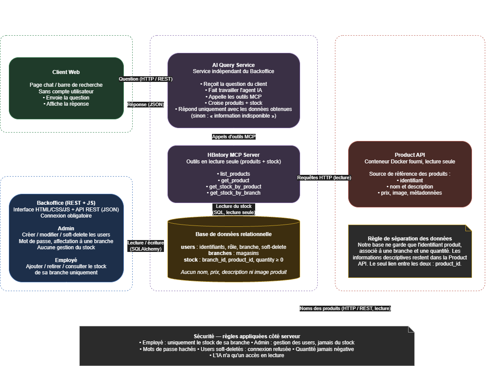

# HBntory — Architecture

HBntory est une plateforme de gestion de stock pour une enseigne fictive à plusieurs agences. Elle a deux faces : un **Backoffice** interne, réservé aux employés connectés, et un **Client Web** public où n'importe qui peut poser une question en langage naturel à un agent IA.

---

## 1. Services du système

| # | Service | Développé par |
| --- | --- | --- |
| 1 | Client Web | L'équipe |
| 2 | AI Query Service | L'équipe |
| 3 | HBntory MCP Server | L'équipe |
| 4 | Backoffice | L'équipe |
| 5 | Base de données PostgreSQL | L'équipe (schéma) |
| 6 | Product API | Fournie (conteneur Docker) |

Chaque service tourne dans son propre conteneur et l'ensemble est lancé avec `docker compose`.

---

## 2. Responsabilité de chaque service

**Client Web** — Page publique, sans authentification. Elle permet à un visiteur de saisir une question en langage naturel, l'envoie à l'AI Query Service et affiche la réponse. Elle ne contient aucune logique métier.

**AI Query Service** — Service backend indépendant du Backoffice. Il reçoit les questions du Client Web et les confie à un agent IA. L'agent obtient les données produits et stock uniquement via les outils MCP, puis formule une réponse fondée sur ces données. Si une information manque, il l'indique clairement au lieu de l'inventer.

**HBntory MCP Server** — Serveur MCP développé par l'équipe. Il expose à l'agent IA des outils en lecture seule et traduit leurs appels :
- vers la Product API pour les produits (`list_products`, `get_product`) ;
- vers la base de données pour le stock (`get_stock_by_product`, `get_stock_by_branch`).

**Backoffice** — Application interne, accessible uniquement après connexion.
- L'**admin** (unique) gère les utilisateurs : liste, création, modification, affectation à une agence, changement de mot de passe, soft delete. Il ne gère jamais le stock.
- Un **utilisateur standard** gère le stock de sa seule agence : ajout, retrait, consultation, liste des produits en stock.

**Base de données PostgreSQL** — Stocke les utilisateurs, les agences et les quantités de stock. Aucune information descriptive sur les produits.

**Product API** — Source externe, en lecture seule, de toutes les informations produits. Elle n'est pas développée par l'équipe.

---

## 3. Communication entre les services

| De | Vers | Protocole | Contenu |
| --- | --- | --- | --- |
| Client Web | AI Query Service | HTTP / REST | La question du visiteur, puis la réponse en JSON |
| AI Query Service | HBntory MCP Server | MCP sur Streamable HTTP | Appels d'outils et leurs résultats |
| HBntory MCP Server | Product API | HTTP / REST | Liste et détail des produits (lecture) |
| HBntory MCP Server | PostgreSQL | SQL | Lecture des quantités de stock |
| Navigateur de l'employé | Backoffice | HTTP / REST (JSON) | Interface HTML/CSS/JS qui appelle l'API du Backoffice |
| Backoffice | PostgreSQL | SQLAlchemy | Lecture et écriture des utilisateurs, agences et stocks |
| Backoffice | Product API | HTTP / REST | Noms et détails des produits à afficher (lecture) |

Les choix de protocoles sont justifiés dans `decisions.md`.

---

## 4. Données stockées localement

| Table | Contenu |
| --- | --- |
| `users` | Identifiant, mot de passe haché (jamais en clair), rôle (`admin` ou `common_user`), agence affectée, indicateur de soft delete |
| `branches` | Les agences de l'enseigne |
| `stock` | `branch_id`, `product_id`, `available_quantity` (entier ≥ 0), une seule ligne par couple agence / produit |

La base ne contient **aucun** nom, description, prix, image ni métadonnée de produit.

---

## 5. Données provenant de la Product API

Toutes les informations descriptives des produits viennent de la Product API :
- identifiant du produit ;
- nom et description ;
- prix ;
- image et autres métadonnées.

**Le seul lien entre la Product API et notre base est le `product_id`.** La Product API dit *ce qu'est* un produit ; notre base dit *où il se trouve et en quelle quantité*.

---

## 6. Accès de l'agent IA aux produits et au stock

L'agent IA n'accède jamais directement à la Product API ni à la base de données. Il passe uniquement par les outils du HBntory MCP Server, tous en lecture seule.

**Exemple** — un visiteur demande : « Où trouver une souris ? »

1. Le Client Web envoie la question à l'AI Query Service.
2. L'agent appelle `list_products` et identifie la souris (`product_id = 34`).
3. L'agent appelle `get_stock_by_product(34)` : 0 à Paris, 8 à Lyon.
4. L'agent répond : « Vous trouverez des souris dans l'agence de Lyon (8 en stock). »

L'IA ne peut ni modifier le stock ni exécuter de requête libre : elle est limitée aux outils définis par l'équipe.

---

## 7. Diagramme

Source modifiable : `HBntory_Architecture_Generale.drawio` (à ouvrir dans draw.io).
