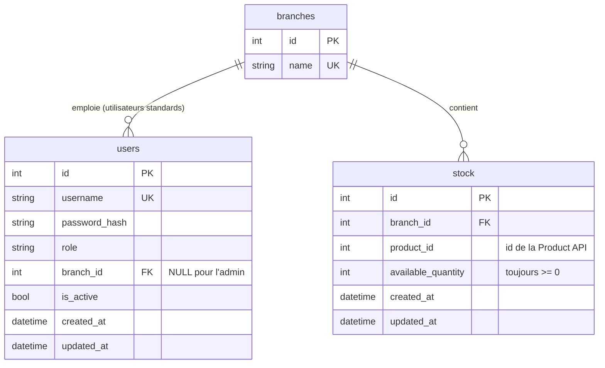

# HBntory — Schéma de la base de données

Ce document décrit la base de données relationnelle du Backoffice (PostgreSQL, accès via SQLAlchemy) : ses tables, leurs relations, leurs contraintes et les règles de validation du stock.

La base contient uniquement les données locales d'HBntory : utilisateurs, agences et quantités de stock. **Aucune information descriptive sur les produits n'y est stockée** : elles restent dans la Product API externe.

---

## 1. Vue d'ensemble

| Table | Contenu |
| --- | --- |
| `branches` | Les agences de l'enseigne |
| `users` | Les comptes du Backoffice (l'admin et les utilisateurs standards) |
| `stock` | Les quantités de chaque produit dans chaque agence |



**Relations :**
- une agence a **plusieurs** utilisateurs standards ; un utilisateur standard appartient à **une seule** agence ; l'admin n'appartient à aucune agence ;
- une agence a **plusieurs** lignes de stock ; une ligne de stock appartient à **une seule** agence.

---

## 2. Table `branches`

| Colonne | Type | Contraintes | Rôle |
| --- | --- | --- | --- |
| `id` | entier | clé primaire | Identifiant de l'agence, utilisé par les clés étrangères |
| `name` | texte | obligatoire, unique | Nom de l'agence (ex. `Paris`, `Lyon`) |

**Choix de conception :**
- Seul le **nom** est stocké : aucune fonctionnalité du projet n'utilise d'adresse ou d'autres informations.
- Le nom est **unique** pour éviter toute ambiguïté, notamment dans les réponses de l'IA.
- **Pas de dates de création ni de mise à jour :** les agences sont créées une seule fois par l'initialisation, et aucune fonctionnalité ne permet de les créer ou de les modifier.
- Les autres tables désignent une agence par son `id`, et non par son nom : un renommage n'affecte que cette table.

---

## 3. Table `users`

| Colonne | Type | Contraintes | Rôle |
| --- | --- | --- | --- |
| `id` | entier | clé primaire | Identifiant de l'utilisateur |
| `username` | texte | obligatoire, unique | Identifiant de connexion (ex. `admin`, `julie`) |
| `password_hash` | texte | obligatoire | Mot de passe **haché**, jamais stocké en clair |
| `role` | texte | obligatoire, `admin` ou `common_user` | Détermine les droits dans le Backoffice |
| `branch_id` | entier | clé étrangère → `branches.id` | Agence de l'utilisateur ; `NULL` pour l'admin uniquement |
| `is_active` | booléen | obligatoire, vrai par défaut | Suppression logique (*soft delete*) |
| `created_at` | date et heure | obligatoire | Date de création du compte |
| `updated_at` | date et heure | obligatoire | Date de dernière modification (mot de passe, agence…) |

**Contraintes de vérification (`CHECK`) :**

1. `role` vaut uniquement `admin` ou `common_user`.
2. Le rôle et l'agence sont liés :
   - **soit** `role = 'admin'` **et** `branch_id` est `NULL` ;
   - **soit** `role = 'common_user'` **et** `branch_id` n'est pas `NULL`.

**Choix de conception :**
- **Un utilisateur standard appartient à exactement une agence** : imposé par la contrainte 2 et par la clé étrangère.
- **L'admin n'a aucune responsabilité de stock** : il n'est rattaché à aucune agence (`branch_id = NULL`, imposé par la contrainte 2). Le Backoffice refuse en plus toute opération de stock pour le rôle `admin` (voir la tâche 2).
- **Soft delete :** supprimer un utilisateur passe `is_active` à `false`. La ligne reste en base, et la connexion est refusée.
- **Dates :** l'admin crée, modifie et désactive des comptes ; les dates permettent de savoir quand.

**Exemple :**

| id | username | role | branch_id | is_active |
| --- | --- | --- | --- | --- |
| 1 | admin | admin | `NULL` | true |
| 2 | julie | common_user | 1 (Paris) | true |

---

## 4. Table `stock`

| Colonne | Type | Contraintes | Rôle |
| --- | --- | --- | --- |
| `id` | entier | clé primaire | Identifiant de la ligne de stock |
| `branch_id` | entier | obligatoire, clé étrangère → `branches.id` | Agence concernée |
| `product_id` | entier | obligatoire | `id` numérique du produit dans la Product API |
| `available_quantity` | entier | obligatoire, **≥ 0** | Nombre d'unités disponibles |
| `created_at` | date et heure | obligatoire | Date à laquelle le produit a commencé à être géré dans l'agence |
| `updated_at` | date et heure | obligatoire | Date du dernier changement de quantité |

**Contraintes :**
- `CHECK (available_quantity >= 0)` : la quantité ne peut jamais être négative.
- **Unicité sur (`branch_id`, `product_id`)** : une seule ligne par agence et par produit.

**Choix de conception :**
- **`product_id` n'est pas une clé étrangère :** les produits ne sont pas dans notre base mais dans la Product API. La base ne peut donc pas vérifier leur existence ; cette vérification est faite par le Backoffice (voir section 5).
- **`product_id` contient l'`id` numérique** de la Product API (et non le SKU) : la route de détail de l'API l'accepte directement, et un entier est simple à stocker et à valider. Voir `product-api.md`.
- **Aucune information produit** (nom, description, prix, image, métadonnées) : le Backoffice et le serveur MCP les récupèrent auprès de la Product API à partir du `product_id`.
- **`updated_at`** donne une traçabilité minimale des changements de quantité. Un historique complet des mouvements n'est pas exigé par le sujet : il est gardé en liste 2 du MVP.

**Exemple :**

| id | branch_id | product_id | available_quantity |
| --- | --- | --- | --- |
| 1 | 1 (Paris) | 34 | 0 |
| 2 | 2 (Lyon) | 34 | 8 |

---

## 5. Règles de validation du stock

| Règle (consigne) | Où elle est appliquée | Comment |
| --- | --- | --- |
| La quantité en stock ne peut pas devenir négative | **Base** + **Backoffice** | `CHECK (available_quantity >= 0)` ; le Backoffice refuse un retrait supérieur au stock disponible, avec un message clair |
| Les modifications de stock exigent des quantités entières positives | **Backoffice** | La quantité demandée pour un ajout ou un retrait doit être un entier strictement positif |
| Les opérations de stock font référence à des agences valides | **Base** + **Backoffice** | Clé étrangère `branch_id` → `branches.id` ; un utilisateur standard ne peut agir que sur son agence |
| Les opérations de stock font référence à des produits existants dans la Product API, lorsque c'est applicable | **Backoffice** | Appel à `GET /api/v1/products/{product_id}` avant de créer une nouvelle ligne de stock |

**Pourquoi ce placement :**
- **Dans la base**, les règles essentielles (quantité jamais négative, agence valide, rôle et agence cohérents) sont garanties **quoi qu'il arrive**, même en cas d'erreur dans le code.
- **Dans le Backoffice**, les règles sont vérifiées **avant** d'écrire en base, pour renvoyer un message d'erreur clair à l'utilisateur plutôt qu'une erreur technique.
- **La vérification du produit** ne peut se faire que dans le Backoffice, car la base n'a pas accès à la Product API.

**Signification de « lorsque c'est applicable » :**
- la vérification auprès de la Product API est faite **lors de la création d'une nouvelle ligne de stock** (produit jamais stocké dans cette agence) ;
- pour une ligne existante, le produit a déjà été vérifié lors de sa création ;
- **si la Product API est indisponible** lors de la création d'une nouvelle ligne, l'opération est **refusée** avec un message clair : l'existence du produit ne peut pas être garantie.

---

## 6. Données initiales

La base est initialisée avec :
- **l'utilisateur `admin`**, avec un mot de passe **haché** ; le mot de passe initial est lu dans une variable d'environnement, jamais écrit en clair dans le code ni dans la base ;
- **au moins deux agences** (ex. `Paris`, `Lyon`) ;
- **du stock d'exemple**, référençant des `id` existants de la Product API, pour tester le Backoffice et l'IA.

*Le mécanisme exact d'initialisation (script ou migrations) sera précisé à l'étape 3 de la tâche 1.*

## Concurrence et dates de mise à jour

### Retraits de stock simultanés

Deux utilisateurs peuvent retirer le même produit dans la même agence au même moment.
Si chaque requête lisait d'abord la quantité, puis écrivait le résultat de son calcul,
le second retrait pourrait écraser le premier et fausser le stock.

Pour l'éviter, un retrait est fait en une seule requête atomique, qui vérifie la quantité
et la modifie en même temps :

```sql
UPDATE stock
SET available_quantity = available_quantity - :quantite
WHERE branch_id = :agence
  AND product_id = :produit
  AND available_quantity >= :quantite;
```

Si aucune ligne n'est modifiée, le stock est insuffisant : l'application refuse le retrait
et renvoie un message clair.

La contrainte `ck_stock_quantity_positive` reste un filet de sécurité :
même en cas d'erreur dans l'application, la base refuse toute quantité négative.

### Mise à jour de `updated_at`

La colonne `updated_at` est mise à jour par SQLAlchemy grâce à `onupdate=db.func.now()`
dans les modèles. Aucun trigger PostgreSQL n'est nécessaire, car toutes les modifications
passent par l'application.
