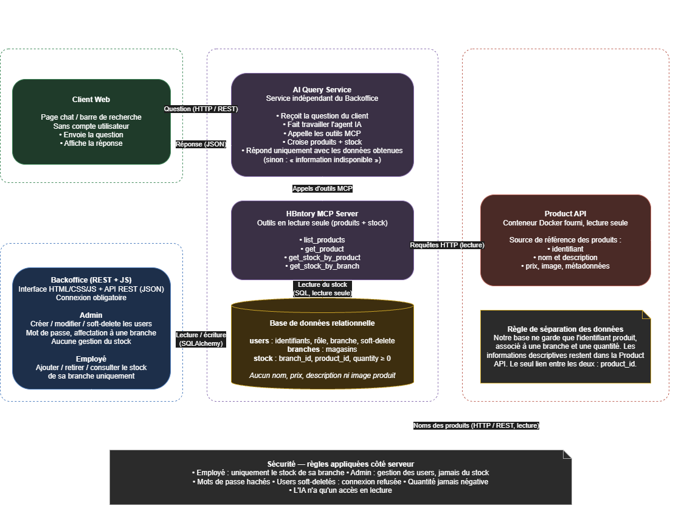

# HBntory — Architecture

## 1. Services du système

## 2. Responsabilité de chaque service

## 3. Communication entre les services

## 4. Données stockées localement

## 5. Données provenant de la Product API

## 6. Accès de l'agent IA aux produits et au stock

## 7. Diagramme

Source modifiable : `HBntory_Architecture_Generale.drawio` (à ouvrir dans draw.io).
